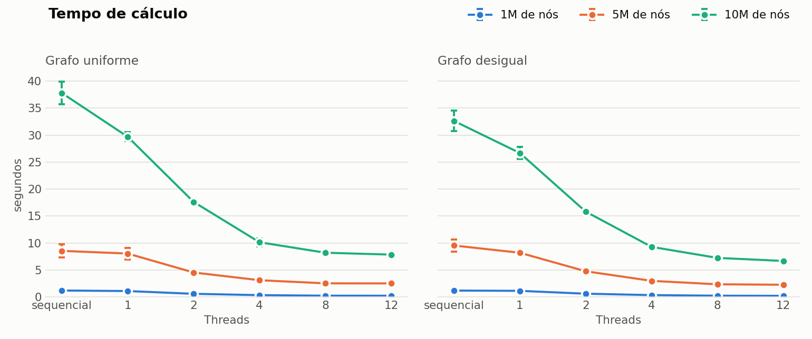
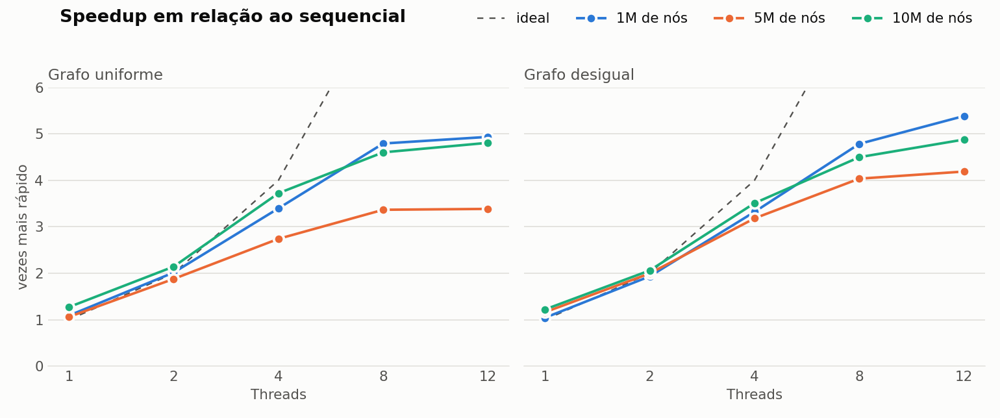
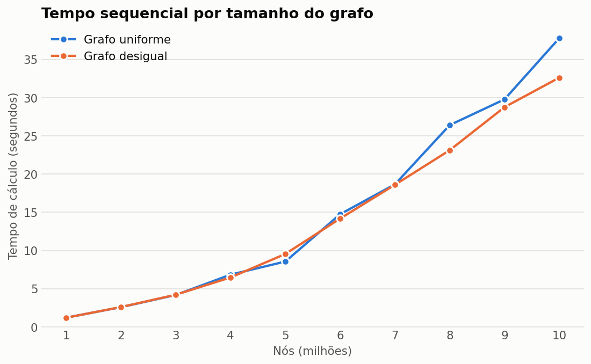

# PageRank paralelo com OpenMP

Este projeto estudou a implementação do PageRank em uma máquina paralela. Foram comparados uma versão sequencial instrumentada e uma versão com OpenMP.

    Autor: Nikolas Ribeiro Klasa

## Descrição do problema e análise do código sequencial

O PageRank calcula a importância de cada página a partir dos links recebidos. Em cada volta, o novo valor é obtido somando os votos dos nós que apontam para o nó atual, aplicando a chance de salto aleatório e calculando a diferença entre duas voltas consecutivas. O processo termina quando a soma das diferenças fica abaixo de `0,001`.

Os arquivos utilizados nos testes são:

- `pagerank_sequencial.cpp`: versão sequencial comentada e com medição de tempos.
- `pagerank_paralelo.cpp`: versão com OpenMP.
- `Codigos_auxiliares/gera_grafo.cpp`: gera os grafos uniforme e desigual.
- `Codigos_auxiliares/testa_sequencial.py`: executa o teste sequencial.
- `Codigos_auxiliares/testa_paralelo.py`: executa o teste paralelo e a comparação direta.
- `Codigos_auxiliares/analisa.py`: gera os gráficos dos resultados.

O arquivo `pagerank.cpp` está no projeto apenas como referência histórica e não é usado pelo Makefile nem pelos testes.

Cada volta percorre todos os nós e todos os links. Assim, o custo teórico é $O(N + M)$ por volta, em que $N$ é o número de nós e $M$ o número de links. Na implementação original, o trabalho mais caro é a votação, que ocupa cerca de 90% do cálculo em uma máquina usual. As demais fases apresentam custo linear em $N$, mas são menores.

## Estratégia de paralelização

### Decomposição

As voltas dependem do resultado da volta anterior, portanto não podem ser executadas ao mesmo tempo. Dentro de cada volta, o trabalho foi dividido entre as threads:

- cálculo dos votos;
- soma dos votos recebidos por cada nó;
- damping;
- residual;
- cópia dos novos valores.

A versão paralela inverte o grafo. Em vez de cada nó escrever nos destinos, cada nó soma os votos dos nós que apontam para ele. Dessa forma, cada posição de acumulador é escrita por uma única thread.

### Sincronização

Não há travas na votação principal. As somas são independentes por posição e o residual usa `reduction`. Barreiras implícitas no fim das regiões `omp parallel for` garantem que uma fase só começa depois da anterior terminar.

### Balanceamento de carga

A soma dos votos usa `schedule(dynamic, 4096)`, porque nós com diferentes quantidades de links podem exigir tempos diferentes. As fases em que cada nó realiza trabalho semelhante usam `schedule(static)`.

A inversão do grafo é feita uma vez antes das voltas e permanece sequencial.

## Ambiente de testes

| Item | Valor |
|:--|:--|
| Sistema | Ubuntu 26.04.1 no WSL2 |
| CPU | AMD Ryzen 5 7600|
| Memória | 32 GiB |
| Compilador | GCC/G++ 15.2.0 |
| Flags | `-O2 -Wall -Wextra`; paralelo também usa `-fopenmp` |

## Metodologia

- Entradas: grafos uniforme e desigual, com semente fixa `42` e grau médio `8`.
- Tamanhos: 1 a 10 milhões de nós.
- Execuções: uma rodada de aquecimento descartada e cinco rodadas válidas.
- Conferência: os arquivos produzidos pelo sequencial e pelo paralelo foram comparados diretamente byte a byte.
- Estatística: média e desvio padrão das cinco execuções válidas.

A comparação direta lê o arquivo sequencial de referência e o arquivo paralelo em blocos de até 1 MiB.

## Como executar

No Ubuntu ou WSL:

```sh
sudo apt update
sudo apt install -y build-essential make python3-matplotlib util-linux
make dados
make teste
```

Comandos disponíveis:

```sh
make          # compila todos os programas
make dados    # gera os 20 grafos
make teste    # executa sequencial, paralelo e análise
make clean    # remove programas e grafos gerados
```

Gerar todos os grafos pode consumir vários gigabytes de disco. `make teste` pode levar várias horas.

## Tabela e gráfico de tempo

Os dados completos estão em `resultados/sequencial.csv` e `resultados/paralelo.csv`. Os tempos estão em segundos; os nós estão em milhões.

### Grafo uniforme

| Nós (milhões) | Sequencial (s) | 1 thread: tempo (s) / speedup | 2 threads: tempo (s) / speedup | 4 threads: tempo (s) / speedup | 8 threads: tempo (s) / speedup | 12 threads: tempo (s) / speedup |
|--:|--:|--:|--:|--:|--:|--:|
| 1 | 1,21 | 1,11 / 1,09× | 0,60 / 2,02× | 0,36 / 3,40× | 0,25 / 4,79× | 0,25 / 4,94× |
| 2 | 2,58 | 2,36 / 1,09× | 1,41 / 1,83× | 0,84 / 3,08× | 0,64 / 4,04× | 0,66 / 3,89× |
| 3 | 4,18 | 3,85 / 1,09× | 2,34 / 1,79× | 1,49 / 2,81× | 1,18 / 3,55× | 1,26 / 3,33× |
| 4 | 6,84 | 5,76 / 1,19× | 3,51 / 1,95× | 2,22 / 3,08× | 1,80 / 3,79× | 1,76 / 3,89× |
| 5 | 8,56 | 8,06 / 1,06× | 4,55 / 1,88× | 3,12 / 2,74× | 2,54 / 3,37× | 2,53 / 3,39× |
| 6 | 14,75 | 11,64 / 1,27× | 6,73 / 2,19× | 3,92 / 3,76× | 3,40 / 4,34× | 3,66 / 4,03× |
| 7 | 18,66 | 15,14 / 1,23× | 9,34 / 2,00× | 5,36 / 3,48× | 4,69 / 3,98× | 4,57 / 4,08× |
| 8 | 26,41 | 19,21 / 1,37× | 11,79 / 2,24× | 7,18 / 3,68× | 5,20 / 5,08× | 5,54 / 4,77× |
| 9 | 29,78 | 25,45 / 1,17× | 14,82 / 2,01× | 8,88 / 3,35× | 6,78 / 4,39× | 6,84 / 4,35× |
| 10 | 37,79 | 29,68 / 1,27× | 17,62 / 2,14× | 10,15 / 3,72× | 8,21 / 4,60× | 7,86 / 4,81× |

### Grafo desigual

| Nós (milhões) | Sequencial (s) | 1 thread: tempo (s) / speedup | 2 threads: tempo (s) / speedup | 4 threads: tempo (s) / speedup | 8 threads: tempo (s) / speedup | 12 threads: tempo (s) / speedup |
|--:|--:|--:|--:|--:|--:|--:|
| 1 | 1,20 | 1,15 / 1,04× | 0,62 / 1,93× | 0,36 / 3,32× | 0,25 / 4,79× | 0,22 / 5,38× |
| 2 | 2,60 | 2,49 / 1,05× | 1,44 / 1,81× | 0,86 / 3,04× | 0,61 / 4,26× | 0,62 / 4,17× |
| 3 | 4,21 | 4,19 / 1,01× | 2,43 / 1,73× | 1,46 / 2,89× | 1,10 / 3,83× | 1,05 / 4,00× |
| 4 | 6,47 | 6,03 / 1,07× | 3,47 / 1,87× | 2,17 / 2,98× | 1,63 / 3,98× | 1,68 / 3,86× |
| 5 | 9,55 | 8,20 / 1,16× | 4,78 / 2,00× | 3,00 / 3,18× | 2,36 / 4,04× | 2,28 / 4,19× |
| 6 | 14,18 | 11,93 / 1,19× | 6,54 / 2,17× | 4,13 / 3,44× | 2,99 / 4,75× | 3,04 / 4,67× |
| 7 | 18,60 | 15,61 / 1,19× | 8,33 / 2,23× | 4,92 / 3,78× | 3,90 / 4,77× | 3,57 / 5,21× |
| 8 | 23,12 | 19,26 / 1,20× | 11,02 / 2,10× | 6,70 / 3,45× | 5,01 / 4,61× | 4,85 / 4,77× |
| 9 | 28,76 | 22,58 / 1,27× | 13,97 / 2,06× | 8,28 / 3,47× | 6,52 / 4,41× | 5,98 / 4,80× |
| 10 | 32,62 | 26,68 / 1,22× | 15,83 / 2,06× | 9,30 / 3,51× | 7,25 / 4,50× | 6,69 / 4,88× |







## Discussão dos resultados e limitações

Na rodada, o melhor ganho observado foi em torno de $5,21\times$ no grafo desigual de 7 milhões de nós com 12 threads. No uniforme de 10 milhões, o tempo caiu de 37,79 s para 7,86 s com 12 threads, aproximadamente $4,81\times$. No uniforme de 8 milhões, o resultado foi próximo de $5,08\times$ com 8 threads.

### Por que existem speedups superlineares?

Um speedup é superlinear quando uma execução com $p$ threads fica mais rápida que $p$ vezes o tempo da referência sequencial. Isso não significa que o algoritmo criou trabalho extra ou que realizou menos operações sem razão. Em geral, o ganho vem de uma mudança na hierarquia de memória.

Com uma thread, o conjunto de dados usado pela votação precisa caber em uma quantidade limitada de cache próxima ao núcleo. Com várias threads, o grafo é dividido e cada núcleo usa sua cache privada. A soma das caches privadas disponíveis pode manter uma parte maior dos dados ativos próxima aos núcleos, diminuindo o número de acessos à memória principal.

Os grafos usados neste projeto são grandes e têm tamanho superior à maioria das caches disponíveis. Além disso, a votação percorre listas e vetores de forma irregular. Nessas condições, distribuir o trabalho pode melhorar o aproveitamento das caches, não apenas dividir o número de operações entre processadores.

Há outro detalhe importante: a comparação não usa exatamente o mesmo programa em uma e várias threads. A versão sequencial percorre o grafo original, enquanto o paralelo converte o grafo para a representação invertida e então efetua a votação por pull. Com uma thread, essa representação já pode ser mais favorável à cache. Por isso, a versão paralela aparece entre 1,04× e 1,37× mais rápida que o sequencial em algumas configurações antes mesmo de haver paralelismo efetivo.

Dessa forma, um speedup superlinear observado pode combinar:

- divisão do trabalho entre mais núcleos;
- maior capacidade agregada de cache;
- melhor acesso local aos dados do grafo invertido;
- diferenças da execução em um ambiente virtualizado pelo WSL2;
- variação normal entre cinco execuções.

A lei de Amdahl ajuda a explicar por que o speedup não acompanha o número de threads: a inversão do grafo continua sequencial e há regiões com criação de threads, barreiras e leitura de memória. O ganho tende a ficar limitado pela parte sequencial e pelo custo de movimentação dos dados.

Os principais gargalos são:

- memória: a votação percorre estruturas e listas com acesso pouco contínuo;
- cache: listas e vetores são acessados por padrões diferentes;
- overhead: cada iteração inicia várias regiões OpenMP e possui barreiras implícitas;
- WSL2: a virtualização pode limitar ou compartilhar a CPU física;
- carga externa: outros processos do Windows e da máquina podem interferir nas medidas.

## Uso de LLMs

Para esse projeto, usei LLM (Copilot) principalmente para ajuda de refinamento de textos e criação de código auxiliar (Makefile, medição, criação de tabelas)

### Prompts usados:

```
Leia e analise o código pagerank_paralelo.cpp e pagerank_sequencial.cpp, crie para eles os sequintes códigos auxiliares:

- gera_grafo: Um seeder que gera grafos uniformes e desequilibrados de 1 Milhão de nós até 10 Milhões que sejam aceitos pelos códigos fornecidos

- check_output: Confere o resultado da versão paralela com o resultado da versão sequencial

- testa_paralelo: Roda todos os testes na versao paralela

- testa_sequencial: Roda todos os testes na versao sequencial

- analisa.py (Unico obrigatoriamente pyhton): Analise os resultados que devem ser feitos em uma tabela .csv e crie graficos com as metricas obtidas, use matplotlib

Após isso, crie um Makefile que consiga compilar, gerar os grafos e rodar os testes de maneira fácil e intuitiva
```

```
Analise o README.md, melhore o texto sem alterar nenhuma informação inserida e formate melhor para um README de github
```

```
Crie no Makefile um comando para limpar todos os arquivos gerados para os testes

```


